# MiniKatalog

MiniKatalog je jednostavna iOS aplikacija izrađena u sklopu seminarskog rada iz kolegija Razvoj aplikacija za mobilne i pametne uređaje, pri čemu je glavna tema rada prikaz strukturiranih podataka u iOS aplikacijama, odnosno način na koji se isti podaci mogu prikazivati korištenjem lista, tablica, mreža i kartica, kao i odgovarajućih kontrola za odabir te indikatora napretka.

Za potrebe primjera koristi se katalog s 24 unaprijed definirana proizvoda koji su podijeljeni u dvije kategorije, **Oprema** i **Računala**, pri čemu se isti skup podataka prikazuje na nekoliko različitih načina kako bi se mogle usporediti mogućnosti pojedinih SwiftUI komponenti. Budući da je naglasak na samom prikazu podataka, aplikacija ne koristi bazu podataka niti se povezuje s vanjskim API-jem.

## Korištene tehnologije

Aplikacija je izrađena u programskom jeziku **Swift**, uz korištenje razvojnog okvira **SwiftUI** i razvojnog okruženja **Xcode**, dok se za prikaz ikona pojedinih proizvoda koriste SF Symbols. Pritom je projekt namijenjen uređajima s operacijskim sustavom **iOS 18.0 ili novijim**, što je ujedno i minimalna verzija sustava postavljena u projektu.

## Struktura projekta

Glavne datoteke projekta nalaze se u direktoriju `MiniKatalog`, pri čemu svaka od njih ima zasebnu ulogu u definiranju podataka ili pojedinog dijela korisničkog sučelja:

| Datoteka | Opis |
| --- | --- |
| `MiniKatalogApp.swift` | Pokretanje aplikacije. |
| `ContentView.swift` | Navigacija između četiri glavna prikaza pomoću `TabView`. |
| `Proizvod.swift` | Model proizvoda. |
| `DemoPodaci.swift` | Unaprijed definirani proizvodi. |
| `PopisView.swift` | Prikaz proizvoda u listi. |
| `MrezaView.swift` | Mreža proizvoda. |
| `KarticaProizvoda.swift` | Izgled pojedine kartice u mreži. |
| `TablicaView.swift` | Usporedba prikaza `Grid`, `Stack` i `Table`. |
| `KontroleView.swift` | Odabir kategorije, filtriranje i indikatori napretka. |

Osim navedenih datoteka, u korijenskom direktoriju nalaze se i `MiniKatalog.xcodeproj`, preko kojeg se projekt otvara u Xcodeu, te direktorij `Slike_aplikacije`, unutar kojega su spremljene snimke zaslona koje prikazuju pojedine funkcionalnosti aplikacije.

## Prikazi i implementacija

### Model podataka

Kako bi se svi proizvodi mogli prikazivati na jednak način, najprije je definiran njihov zajednički model, odnosno struktura koja za svaki proizvod sadrži identifikator, naziv, kategoriju, cijenu i simbol, a nalazi se u datoteci `Proizvod.swift`:

```swift
struct Proizvod: Identifiable {
    let id: Int
    let naziv: String
    let kategorija: String
    let cijena: Int
    let simbol: String
}
```

Struktura implementira protokol `Identifiable`, čime se omogućuje razlikovanje pojedinih proizvoda prilikom prikaza unutar zbirki, dok su sami proizvodi unaprijed definirani u datoteci `DemoPodaci.swift`, iz koje svi ostali prikazi koriste isti niz `DemoPodaci.proizvodi`.

Primjer jednog proizvoda, odnosno zapisa iz datoteke `DemoPodaci.swift`, izgleda ovako:

```swift
Proizvod(id: 1, naziv: "Tipkovnica", kategorija: "Oprema", cijena: 35, simbol: "keyboard")
```

Budući da aplikacija sadrži četiri odjeljka u kojima se prikazuju isti podaci, njihov je pristup organiziran preko glavnog prikaza u datoteci `ContentView.swift`, gdje se pomoću komponente `TabView` povezuju sljedeći prikazi:

```swift
TabView {
    Tab("Popis", systemImage: "list.bullet") {
        PopisView()
    }
    Tab("Mreža", systemImage: "square.grid.2x2") {
        MrezaView()
    }
    Tab("Tablica", systemImage: "tablecells") {
        TablicaView()
    }
    Tab("Kontrole", systemImage: "slider.horizontal.3") {
        KontroleView()
    }
}
```

### Popis

U prvom odjeljku proizvodi se prikazuju pomoću komponente `List`, pri čemu svaki redak sadrži simbol, naziv, kategoriju i cijenu pojedinog proizvoda, dok se sami redci generiraju pomoću `ForEach`, koji prolazi kroz unaprijed definirani niz proizvoda.

```swift
List {
    ForEach(DemoPodaci.proizvodi) { proizvod in
        HStack(spacing: 12) {
            Image(systemName: proizvod.simbol)
            VStack(alignment: .leading) {
                Text(proizvod.naziv)
                Text(proizvod.kategorija)
            }
            Spacer()
            Text("\(proizvod.cijena) €")
        }
    }
}
```

*Prikazani isječak obuhvaća osnovni raspored pojedinog retka, dok se ostali modifikatori kojima se uređuje njegov izgled nalaze u datoteci `PopisView.swift`.*

Pritom je u datoteci `PopisView.swift` lista smještena unutar komponente `NavigationStack`, a dodatno su postavljeni naslov prikaza i odgovarajući grupirani stil liste:

```swift
.listStyle(.insetGrouped)
.navigationTitle("Popis proizvoda")
```


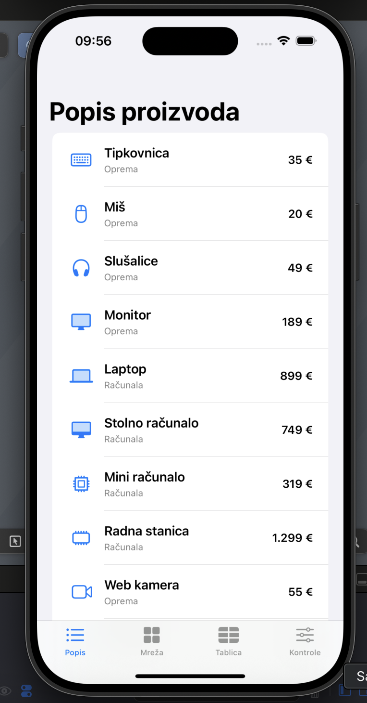

### Mreža i kartice

U drugom odjeljku isti se proizvodi prikazuju u obliku mreže koja se sastoji od dva stupca, pri čemu se za njihov raspored koristi `LazyVGrid`, dok je izgled pojedinog proizvoda definiran u zasebnoj komponenti unutar datoteke `KarticaProizvoda.swift`, čime se izbjegava nepotrebno ponavljanje jednakog koda za svaku karticu.

```swift
private let stupci = [
    GridItem(.flexible()),
    GridItem(.flexible())
]

LazyVGrid(columns: stupci, spacing: 12) {
    ForEach(DemoPodaci.proizvodi) { proizvod in
        KarticaProizvoda(proizvod: proizvod)
    }
}
```

S obzirom na to da se svi proizvodi ne mogu istodobno prikazati na zaslonu, mreža je smještena unutar `ScrollView`, koji omogućuje pomicanje sadržaja, dok `LazyVGrid` podprikaze stvara prema potrebi, odnosno ne mora unaprijed stvoriti sve elemente mreže.

U datoteci `MrezaView.swift` navedene su komponente povezane na sljedeći način:

```swift
ScrollView {
    LazyVGrid(columns: stupci, spacing: 12) {
        ForEach(DemoPodaci.proizvodi) { proizvod in
            KarticaProizvoda(proizvod: proizvod)
        }
    }
    .padding()
}
```

Sam izgled pojedine kartice, koji je jednak za sve proizvode i razlikuje se samo prema proslijeđenim podacima, definiran je u zasebnoj datoteci:

```swift
VStack(spacing: 8) {
    Image(systemName: proizvod.simbol)
        .font(.system(size: 35))
        .foregroundStyle(.blue)
        .frame(height: 50)
    Text(proizvod.naziv)
        .font(.headline)
        .lineLimit(1)
        .minimumScaleFactor(0.75)
    Text(proizvod.kategorija)
        .font(.caption)
        .foregroundStyle(.secondary)
    Text("\(proizvod.cijena) €")
        .bold()
}
.frame(maxWidth: .infinity, minHeight: 135)
.padding(12)
.background(Color(.secondarySystemGroupedBackground))
.clipShape(RoundedRectangle(cornerRadius: 14))
```


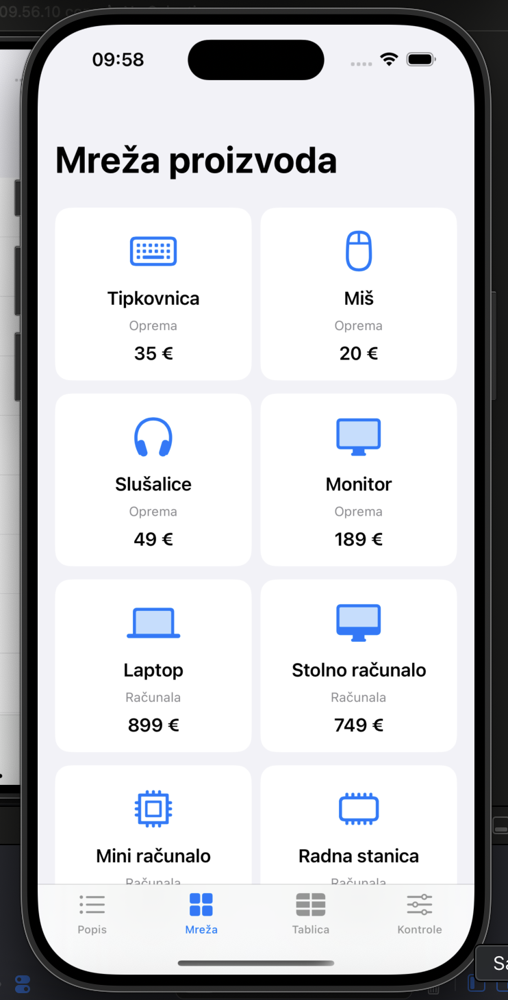

Budući da je sadržaj moguće pomicati, mreža nakon pomicanja prikazuje i ostale proizvode:

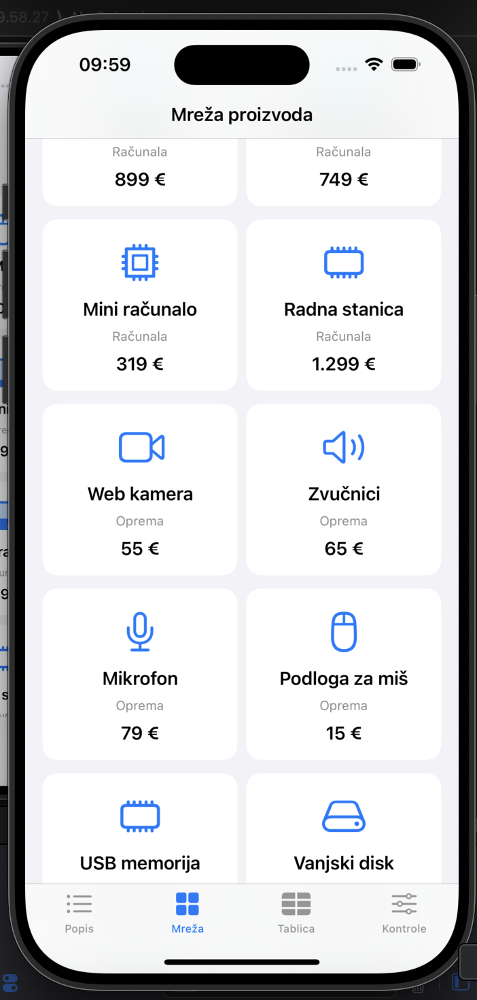

### Tablični prikaz

Odjeljak **Tablica** omogućuje usporedbu triju različitih načina raspoređivanja istih podataka, pri čemu se između njih prebacuje pomoću segmentiranog elementa `Picker`:

- **Grid** – prikazuje naziv, kategoriju i cijenu u usklađenim stupcima.
- **Stack** – koristi `VStack` i `HStack` za jednostavnije retke s nazivom i cijenom.
- **Table** – koristi `Table` i `TableColumn` za tablični prikaz podataka.

Trenutačno odabrani raspored pohranjuje se u varijablu označenu s `@State`, tako da se promjenom odabira mijenja komponenta kojom se proizvodi prikazuju, dok sam niz podataka pritom ostaje nepromijenjen.

Kako bi se tri dostupna rasporeda mogla jednoznačno razlikovati, u datoteci `TablicaView.swift` najprije je definirana sljedeća enumeracija:

```swift
private enum VrstaTablice: String, CaseIterable, Identifiable {
    case grid = "Grid"
    case stack = "Stack"
    case table = "Table"

    var id: String { rawValue }
}
```

Nakon toga odabranu vrijednost čuvamo u stanju prikaza i povezujemo je s kontrolom za odabir rasporeda:

```swift
@State private var vrstaTablice: VrstaTablice = .grid

Picker("Vrsta prikaza", selection: $vrstaTablice) {
    ForEach(VrstaTablice.allCases) { vrsta in
        Text(vrsta.rawValue).tag(vrsta)
    }
}
.pickerStyle(.segmented)
```

Ovisno o tome koja je vrijednost odabrana, pomoću naredbe `switch` prikazuje se odgovarajući raspored, dok se ostali rasporedi u tom trenutku ne koriste:

```swift
switch vrstaTablice {
case .grid:
    ScrollView {
        tablicaGrid
    }
case .stack:
    ScrollView {
        tablicaStack
    }
case .table:
    Text("Na iPhoneu Table prikazuje samo prvi stupac.")
        .font(.footnote)
        .foregroundStyle(.secondary)
    tablicaTable
}
```

Kod prikaza `Grid` zaglavlje i svaki pojedini proizvod predstavljeni su komponentom `GridRow`, čime se podaci raspoređuju u međusobno usklađene stupce:

```swift
Grid(alignment: .leading, horizontalSpacing: 10, verticalSpacing: 12) {
    GridRow {
        Text("Naziv").bold()
        Text("Kategorija").bold()
        Text("Cijena").bold()
    }
    ForEach(DemoPodaci.proizvodi) { proizvod in
        GridRow {
            Text(proizvod.naziv)
                .lineLimit(1)
                .minimumScaleFactor(0.7)
            Text(proizvod.kategorija)
                .lineLimit(1)
                .minimumScaleFactor(0.8)
            Text("\(proizvod.cijena) €")
                .lineLimit(1)
        }
    }
}
```


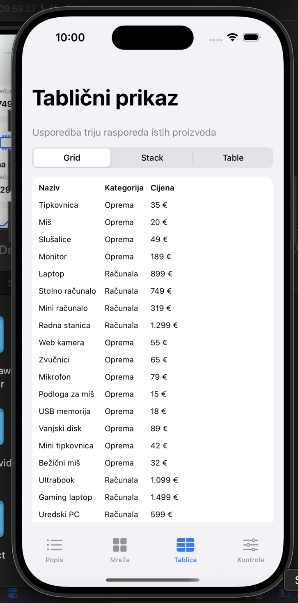

Za razliku od toga, prikaz `Stack` koristi `VStack` za okomito nizanje proizvoda, dok se unutar njega za svaki proizvod stvara zaseban `HStack` koji raspoređuje naziv i cijenu vodoravno:

```swift
VStack(spacing: 0) {
    ForEach(DemoPodaci.proizvodi) { proizvod in
        HStack {
            Text(proizvod.naziv)
            Spacer()
            Text("\(proizvod.cijena) €")
                .bold()
        }
        .padding(12)
        Divider()
    }
}
```


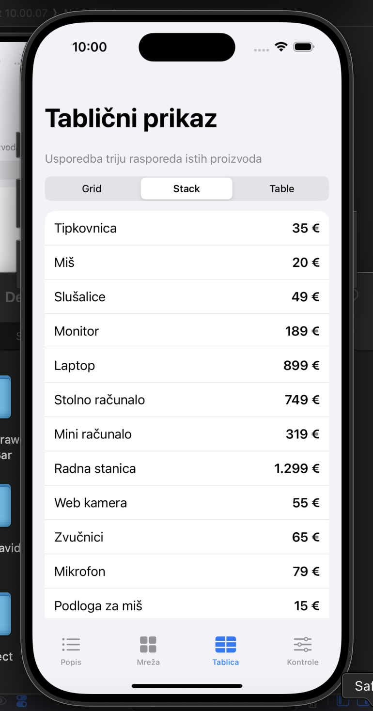

Treći način prikaza koristi komponentu `Table`, pri čemu se pomoću `TableColumn` određuje koje će se svojstvo proizvoda prikazivati u pojedinom stupcu:

```swift
Table(DemoPodaci.proizvodi) {
    TableColumn("Naziv", value: \.naziv)
    TableColumn("Kategorija", value: \.kategorija)
}
.frame(maxHeight: .infinity)
```


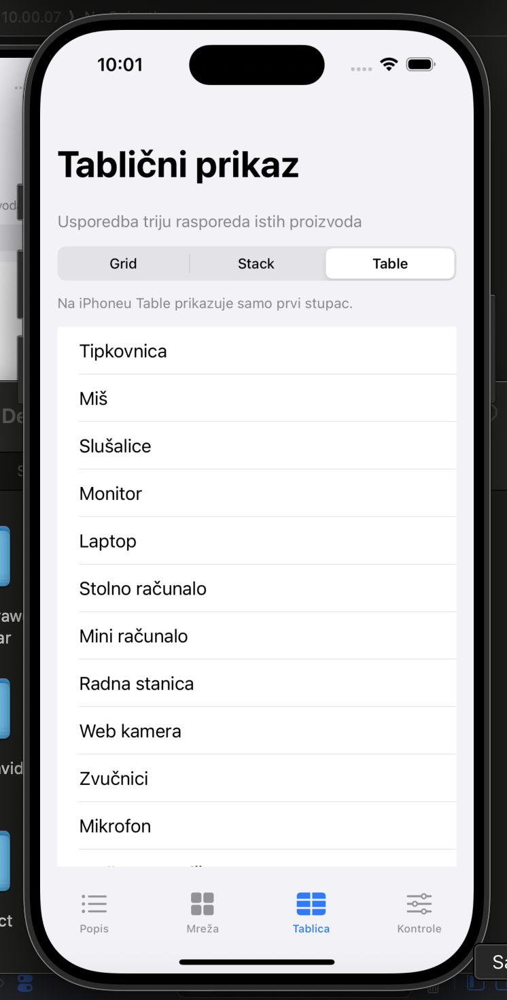

Pritom je važno napomenuti da `Table` na iPhoneu, zbog kompaktne širine zaslona, prema zadanim postavkama prikazuje samo prvi stupac, zbog čega je za naš primjer `Grid` prikladniji kada želimo istodobno prikazati naziv, kategoriju i cijenu proizvoda.

### Odabir kategorije i filtriranje

U odjeljku **Kontrole** korisnik pomoću komponente `Picker` može odabrati jednu od triju mogućnosti, odnosno **Sve**, **Oprema** ili **Računala**, pri čemu se odabrana vrijednost pohranjuje u stanje prikaza, a zatim se na temelju nje određuje koje proizvode treba prikazati korištenjem metode `filter`:

```swift
private var filtriraniProizvodi: [Proizvod] {
    if kategorija == "Sve" {
        return DemoPodaci.proizvodi
    }

    return DemoPodaci.proizvodi.filter {
        $0.kategorija == kategorija
    }
}
```

Ako je odabrana mogućnost **Sve**, prikazuju se sva 24 proizvoda, dok se odabirom bilo koje od preostalih kategorija broj prikazanih proizvoda smanjuje na 12, pri čemu se dobiveni rezultati prikazuju pomoću `LazyVStack` unutar komponente `ScrollView`.

U datoteci `KontroleView.swift` definirani su odabir kategorije i ispis broja proizvoda koji odgovaraju trenutačno odabranoj kategoriji:

```swift
@State private var kategorija = "Sve"
private let kategorije = ["Sve", "Oprema", "Računala"]

Picker("Kategorija", selection: $kategorija) {
    ForEach(kategorije, id: \.self) { naziv in
        Text(naziv).tag(naziv)
    }
}
.pickerStyle(.wheel)
.frame(height: 140)

Text("Broj proizvoda: \(filtriraniProizvodi.count)")
```

Nakon filtriranja proizvodi se prikazuju unutar komponente `LazyVStack`, pri čemu je za svaki od njih definiran jednostavan redak sa simbolom, nazivom i cijenom:

```swift
LazyVStack(alignment: .leading, spacing: 8) {
    ForEach(filtriraniProizvodi) { proizvod in
        HStack(spacing: 12) {
            Image(systemName: proizvod.simbol)
                .foregroundStyle(.blue)
                .frame(width: 24)
            Text(proizvod.naziv)
            Spacer()
            Text("\(proizvod.cijena) €")
                .bold()
        }
        .font(.subheadline)
        .padding(12)
        .background(Color(.secondarySystemGroupedBackground))
        .clipShape(RoundedRectangle(cornerRadius: 10))
    }
}
```


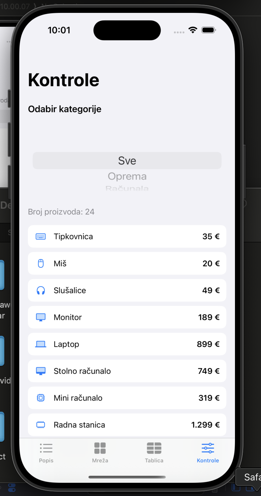

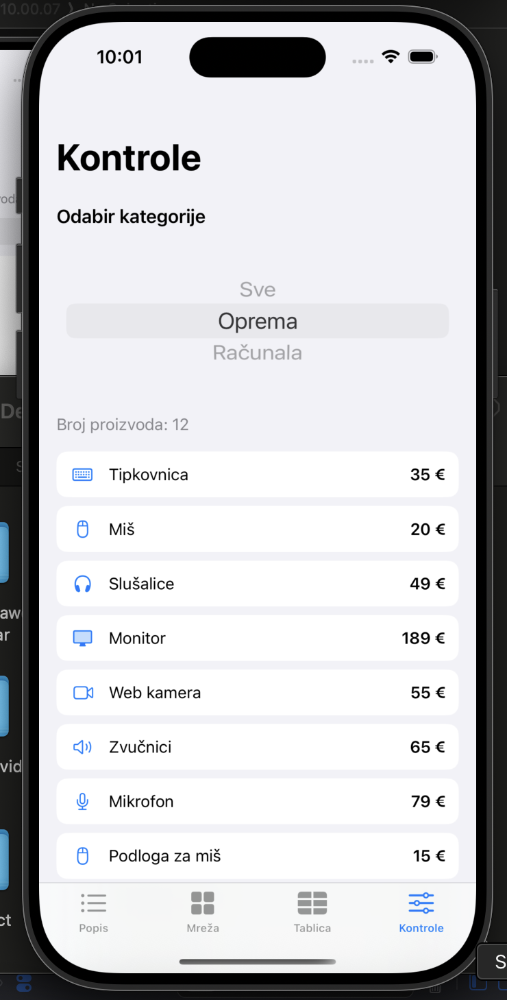

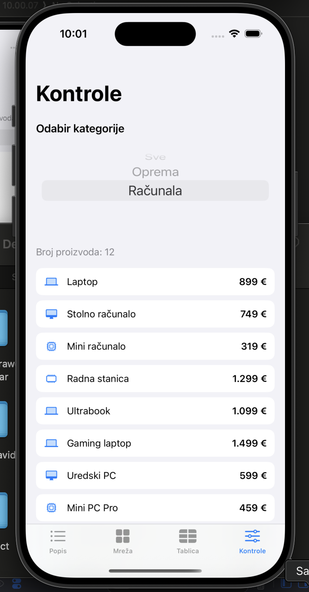

Budući da se radi o pomičnom prikazu, nakon pomicanja dostupni su i proizvodi koji se nisu nalazili u početnom vidljivom dijelu:

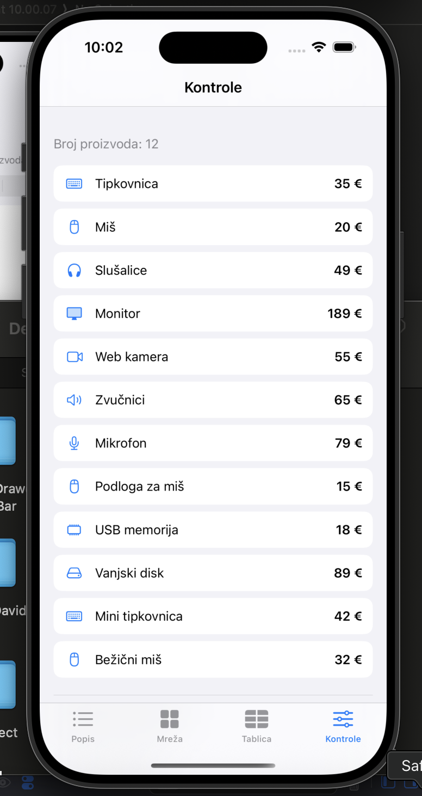

### Indikatori napretka

Na dnu odjeljka **Kontrole** nalaze se dva primjera komponente `ProgressView`, pri čemu se kružni indikator uključuje ili isključuje pomoću kontrole `Toggle`, dok je drugi indikator linearnog oblika i prikazuje unaprijed zadanu vrijednost od 65 %.

```swift
if prikaziIndikator {
    ProgressView("Demonstracija indikatora")
}

ProgressView(value: 0.65, total: 1.0)
    .progressViewStyle(.linear)
```

Pritom je uključivanje kružnog indikatora povezano s varijablom stanja, što omogućuje da se njegov prikaz mijenja ovisno o trenutačnoj vrijednosti kontrole:

```swift
@State private var prikaziIndikator = false

Toggle("Prikaži indikator", isOn: $prikaziIndikator)
```


Potrebno je naglasiti da su oba indikatora isključivo demonstracijska, odnosno da aplikacija ne provodi stvarno učitavanje podataka niti kakvu drugu dugotrajniju operaciju, zbog čega prikazana vrijednost od 65 % ne predstavlja stvarni napredak izvođenja nekog zadatka.

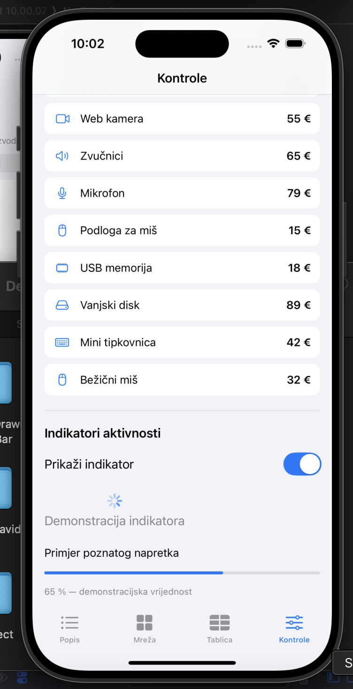

## Pokretanje projekta

Za pokretanje projekta potrebno je računalo s operacijskim sustavom macOS i instaliranim Xcodeom, kao i dostupan iPhone simulator koji podržava iOS 18.0 ili noviji, budući da je upravo ta verzija postavljena kao minimalna verzija iOS-a za aplikaciju.

1. Preuzeti repozitorij pomoću opcije **Code → Download ZIP** ili naredbom `git clone https://github.com/fperak24/RAMPU-reciklirajuci-pogledi.git`.
2. Otvoriti datoteku `MiniKatalog.xcodeproj` u Xcodeu.
3. Odabrati shemu `MiniKatalog` i željeni iPhone simulator.
4. Pokrenuti aplikaciju pomoću **Product → Run** ili prečaca **⌘R**.

Nakon navedenih koraka aplikacija se može pokrenuti bez dodatne konfiguracije, s obzirom na to da su svi demonstracijski podaci već definirani unutar samog projekta.

## Korištenje aplikacije

Nakon pokretanja aplikacije automatski se otvara odjeljak **Popis**, dok su ostali odjeljci dostupni putem navigacijske trake na dnu zaslona, pri čemu se u **Mreži** proizvodi pregledavaju pomicanjem sadržaja, u **Tablici** se pomoću segmentirane kontrole odabire željeni raspored, a u **Kontrolama** se odabire kategorija proizvoda i pregledavaju primjeri indikatora napretka.

S obzirom na to da je svrha aplikacije prvenstveno prikazati i usporediti različite komponente za prikaz strukturiranih podataka, nisu implementirane mogućnosti dodavanja, uređivanja ili brisanja proizvoda, kao ni trajna pohrana podataka ili njihovo dohvaćanje putem interneta. Također je važno razlikovati SwiftUI-jevo *lazy* stvaranje prikaza od ponovne uporabe ćelija u komponentama `UITableView` i `UICollectionView`, budući da se radi o različitim mehanizmima, pri čemu je potonji obrađen u teorijskom dijelu seminara.

## Izvori

Prilikom izrade aplikacije i objašnjavanja korištenih komponenti oslanjao sam se na službenu Appleovu dokumentaciju, odnosno na sljedeće izvore:

- [SwiftUI – Displaying data in lists](https://developer.apple.com/documentation/swiftui/displaying-data-in-lists)
- [SwiftUI – Grid](https://developer.apple.com/documentation/swiftui/grid)
- [SwiftUI – Table](https://developer.apple.com/documentation/swiftui/table)
- [SwiftUI – LazyVGrid](https://developer.apple.com/documentation/swiftui/lazyvgrid)
- [SwiftUI – Picker](https://developer.apple.com/documentation/swiftui/picker)
- [SwiftUI – ProgressView](https://developer.apple.com/documentation/swiftui/progressview)
- [SwiftUI – TabView](https://developer.apple.com/documentation/swiftui/tabview)
- [Apple Human Interface Guidelines](https://developer.apple.com/design/human-interface-guidelines/)

Za potrebe usporedbe SwiftUI-ja i UIKita s Androidovim `RecyclerView` korišteni su i nastavni materijali kolegija, budući da je ta usporedba dio teorijskog dijela seminarskog rada.

Fernando Perak  
Fakultet organizacije i informatike, Varaždin  
Razvoj aplikacija za mobilne i pametne uređaje
